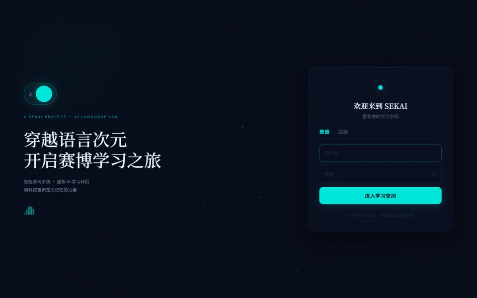

# 📖 English Word Learning · 英语单词学习系统

> **Spring Boot + JPA 后端 · Vue 3 前端 · 随机出题 · 错题本 · CSV 词库导入**
> Full-stack vocabulary learning system with smart answer checking & wrong-answer notebook

[](https://www.oracle.com/java/)
[](https://spring.io/projects/spring-boot)
[](https://spring.io/projects/spring-data-jpa)
[](https://vuejs.org/)
[](https://axios-http.com/)
[](https://www.mysql.com/)
[](LICENSE)

前后端分离的英语单词学习 Web 系统：后端 **Spring Boot + Spring Data JPA + MySQL**，前端 **Vue 3 + Axios + 原生 CSS**，统一端口 `8088`。完整支持随机出题、精确答案校验、错题本、CSV 词库导入。

A full-stack vocabulary learning app: random quizzing, precise answer checking, a wrong-answer notebook, and CSV word-bank import.

## ✨ 功能亮点 Features

- 用户注册/登录（BCrypt 加密，请求头 `X-User-Id` 区分个人数据）Auth
- **随机出题**：接口只返回英文，不提前暴露中文答案 Random quizzing
- **智能答案校验**：多释义精确匹配（不使用 `contains`，"多方面的"不会误判"方面的"）Smart answer checking
- **错题本**：自动收录、删除、清空、CSV 导出 Wrong-answer notebook
- 三种练习模式：公共词库 / 只练错题 / 自定义词库 Practice modes
- 自定义词库持久化到 MySQL Custom word banks
- 学习记录：每轮练习统计 Learning stats
- 智能查询：中英自动识别，忽略大小写/中文模糊查询 Smart search
- 大型英中词库导入（ECDICT `ecdict.csv`）Large dictionary import

## 📐 项目结构 Project Structure

```text
english-word-learning
├── pom.xml
├── database
│   ├── schema.sql           # 建表 + 示例公共单词
│   └── import-template.csv
├── src/main/java/com/example/wordlearning
│   ├── WordLearningApplication.java
│   ├── config / control / dataobject / model
│   ├── repository           # Spring Data JPA
│   ├── service / util
│   └── ...
├── src/main/resources
│   ├── application.properties
│   └── static               # 前端构建产物
└── frontend                 # Vue 3 源码
    ├── package.json
    └── src/views
```

核心工具类：

- `util/AnswerJudgeUtil.java`：答案清洗与多答案完整匹配
- `util/CsvImportUtil.java`：CSV 词库导入

## ▶️ 运行步骤 Run

1. 创建并导入数据库：

```bash
mysql -uroot -p < database/schema.sql
mysql -uroot -p --default-character-set=utf8mb4 sekai_friend < database/cet6_words.sql
mysql -uroot -p --default-character-set=utf8mb4 sekai_friend < database/word_bank_booster.sql
```

导入大型开源英中词库（可选）：

```bash
python database/import_ecdict.py --csv /path/to/ecdict.csv
python database/cleanup_word_meanings.py
```

2. 数据库连接在 `application.properties`（密码用环境变量 `DB_PASSWORD`）：

```properties
spring.datasource.url=jdbc:mysql://127.0.0.1:3306/sekai_friend?serverTimezone=Asia/Shanghai&useUnicode=true&characterEncoding=utf-8&useSSL=false&allowPublicKeyRetrieval=true
spring.datasource.username=root
spring.datasource.password=${DB_PASSWORD:123456}
server.port=8088
```

3. 打包前端到静态目录（当前已内置构建产物）：

```bash
cd frontend
npm install
npm run build
# 把 frontend/dist 内容复制到 src/main/resources/static
```

4. 启动后端并访问：

```bash
mvn spring-boot:run
# http://localhost:8088/login
```

## 🧠 设计要点 Design Notes

前端 Vue 通过 Axios 请求后端；`control` 接收请求 → `service` 处理业务 → `repository` 访问 MySQL → 组装 `model` DTO 统一返回。随机出题走 `/api/words/random`，只返回 `id` 和 `english`；答案校验时后端按中文分号、英文分号、顿号、逗号拆分多个释义，只做完整匹配。

## 🔭 后续扩展方向 Roadmap

发音功能 · 音标播放 · 例句朗读 · 学习日历 · 高频错题优先复习 · Excel 导出错题本 · AI/向量语义判断

## 📄 License

[MIT](LICENSE) © 2026 [sekai-lyr](https://github.com/sekai-lyr)

<p align="center">
  
</p>

---

**⭐ If this project helped you, star it! 如果这个项目对你有帮助，欢迎 Star！**
